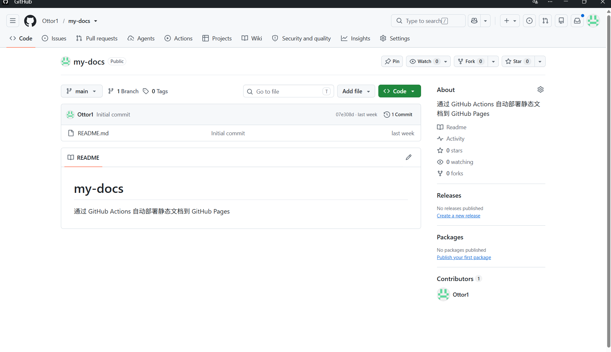
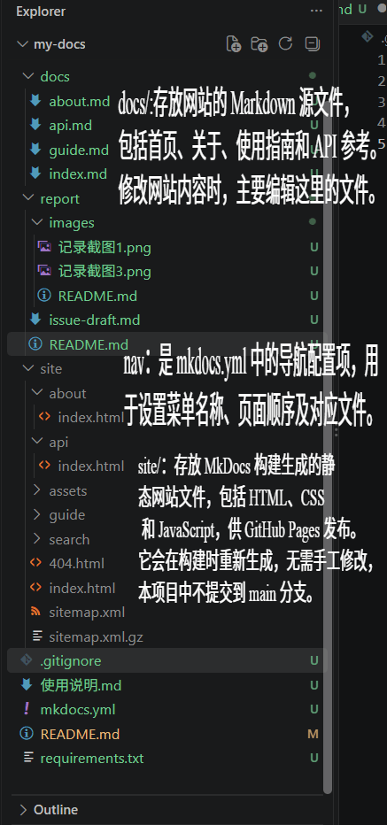
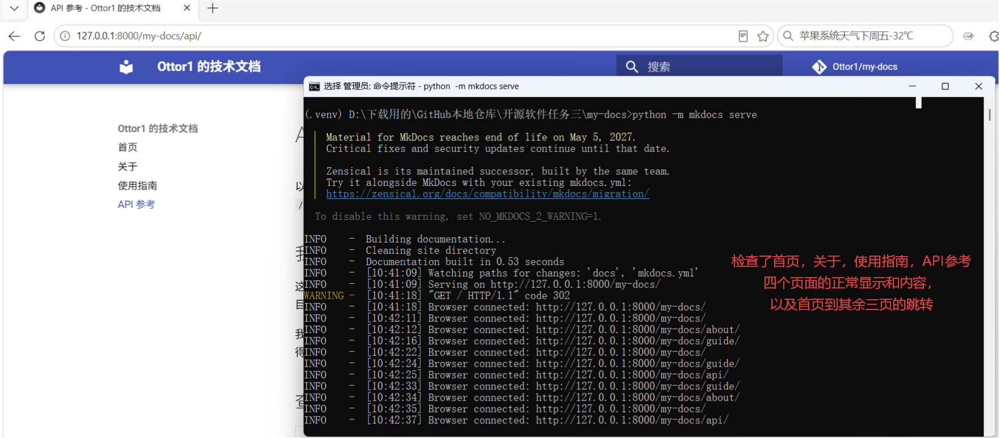
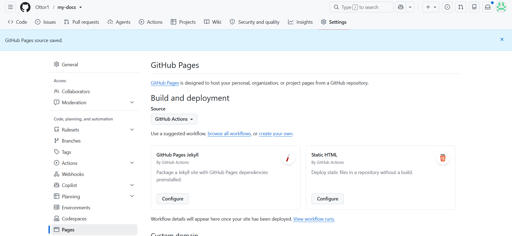
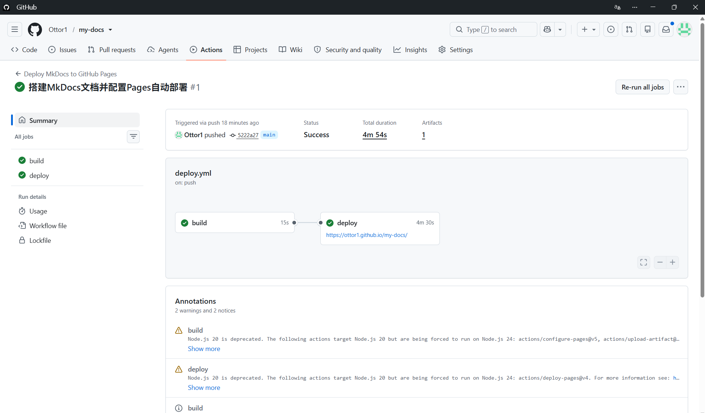
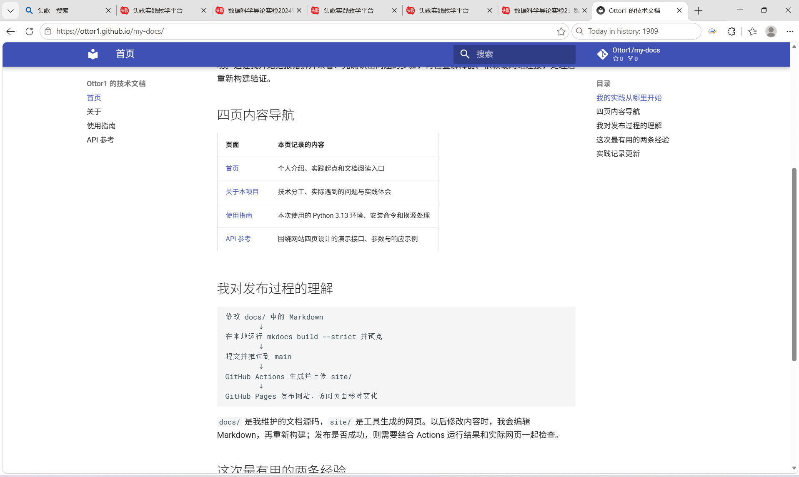
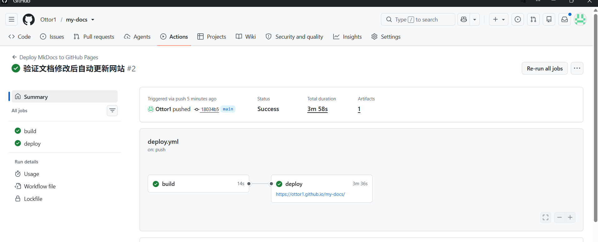
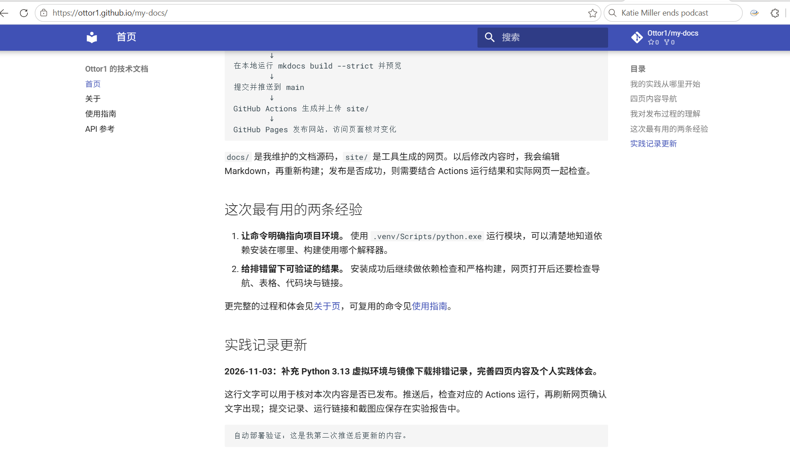

# 实践项目2：个人实验报告

## 1. 基本信息

- GitHub 登录名：Ottor1
- 个人仓库：<https://github.com/Ottor1/my-docs>
- 最终网站：<https://ottor1.github.io/my-docs/>
- 实验环境：Windows、Python 3.13.9、MkDocs 1.6.1、MkDocs Material 9.8.0

这次实验使用 MkDocs 搭建四页文档网站，通过 GitHub Actions 完成首次发布和第二次内容更新。网站内容包括个人介绍、项目说明、使用指南和一个文档列表接口示例。

## 2. 实验过程

### 2.1 创建仓库

我在自己的 GitHub 账号下创建了 `my-docs`，选择 Public，并添加 README。仓库使用 `main` 分支保存源码。下图是仓库创建后的页面，可以看到账号、仓库名称和 Public 标识。



### 2.2 整理目录和配置导航

我把四个页面放在 `docs/` 中，分别是 `index.md`、`about.md`、`guide.md` 和 `api.md`，在 `mkdocs.yml` 中设置网站名称、中文主题和导航顺序。

```yaml
site_name: Ottor1 的技术文档
site_url: https://ottor1.github.io/my-docs/
repo_url: https://github.com/Ottor1/my-docs
theme:
  name: material
  language: zh
nav:
  - 首页: index.md
  - 关于: about.md
  - 使用指南: guide.md
  - API 参考: api.md
```

这里有三个容易混淆的地方：

 `docs/` -> 保存自己编写的 Markdown 页面，是修改网站内容的位置 
 `nav` -> 配置文件中的导航项，决定菜单名称、顺序和对应页面；路径相对于 `docs/` 
 `site/` -> 构建生成的 HTML、样式和脚本，是发布时使用的网站文件 

首页加入了个人介绍和页面导航表格，关于页说明工具分工与实践体会，使用指南记录环境和命令，API 页提供参数表与 JSON 示例。各页之间使用相对链接。API 只作为文档示例，没有实现后端服务。

我还在 `.gitignore` 中加入了 `site/`、`.venv/` 和 Python 缓存，避免把构建产物和本地环境一起提交。



### 2.3 安装依赖和本地预览

电脑上原来安装的是 Anaconda 的 Python 3.13.9。我使用这个版本在项目目录创建 `.venv`，再在虚拟环境中安装依赖：

```powershell
python -m venv .venv
.\.venv\Scripts\python.exe -m pip install -r requirements.txt
.\.venv\Scripts\python.exe -m pip check
.\.venv\Scripts\python.exe -m mkdocs build --strict
.\.venv\Scripts\python.exe -m mkdocs serve
```

直接写出 `.venv` 中的解释器路径，可以明确选择运行环境。截图中已经激活了虚拟环境，所以使用的是简写命令 `python -m mkdocs serve`。

安装后，`pip check` 输出 `No broken requirements found.`，严格构建成功。预览服务启动后，我打开终端给出的 `http://127.0.0.1:8000/my-docs/`，依次访问首页、关于、使用指南和 API 参考，检查表格、代码块以及页面跳转。终端中也记录了四个页面的访问。



### 2.4 设置 Pages 发布来源

我在仓库的 `Settings → Pages` 中找到 `Build and deployment`，把 Source 选为 GitHub Actions。保存后页面显示 `GitHub Pages source saved.`。



### 2.5 编写自动部署工作流

我在 `.github/workflows/deploy.yml` 中设置了 `build` 和 `deploy` 两个任务。`build` 使用 Python 3.12 安装依赖、严格构建文档，然后上传 `site/`；`deploy` 通过 `needs: build` 等待构建成功，再发布这份产物。

`push` -> 推送到 `main`，且修改了文档、配置、依赖或工作流本身时，自动启动工作流 
`workflow_dispatch` -> 允许从 Actions 页面手动运行，方便重试和排错 
`build` -> 把 Markdown 源码构建成静态网页，并上传构建产物 
`needs: build` -> 构建成功后才运行部署任务 
`pages: write`、`id-token: write` -> 给部署任务发布 Pages 和验证身份所需的权限 
`github-pages` -> 保存网站部署记录，并应用相应的环境规则 

### 2.6 首次构建和部署

第一次将文档、配置和工作流推送到 main 后，Actions 自动运行。运行 #1 对应提交 5222a27，总状态为 Success，build 和 deploy 均成功，部署结果中给出了网站地址。

- 首次提交：[5222a27](https://github.com/Ottor1/my-docs/commit/5222a279c7c298c497d04b22c47b27654fdb9953)
- Actions 记录：[首次构建和部署](https://github.com/Ottor1/my-docs/actions/runs/42643324135)



### 2.7 访问网站并检查四页导航

部署完成后，我打开 <https://ottor1.github.io/my-docs/>，依次访问首页、关于、使用指南和 API 参考。四页均能正常打开，页面间链接、表格和代码块也能显示。

网站左侧的四个菜单用于切换页面；右侧的“目录”对应当前页面中的各级标题。首页正文中的“四页内容导航”表格也提供了各页入口。检查后，我保存了带浏览器地址栏的网站截图。



### 2.8 第二次推送验证自动更新

首次部署后，我在 docs/index.md 末尾加入一段容易辨认的文字：

> 自动部署验证：这是我第二次推送后更新的内容。

随后完成提交并推送到 main，提交说明为“验证文档修改后自动更新网站”。第二次运行 #2 对应提交 18034b5，截图中的 Triggered via push 表明它由这次推送自动触发。运行结束后，build、deploy 和总状态均为 Success。

- 对应提交：[18034b5](https://github.com/Ottor1/my-docs/commit/18034b5e9759b5b389f8ef549961589ba6e1a574)
- Actions 记录：[第二次 push 自动更新网站](https://github.com/Ottor1/my-docs/actions/runs/42650554962)



运行成功后，我刷新同一个网站地址，确认首页出现新增文字。这样可以把本次源码修改、自动部署记录和网页变化对应起来，验证修改文档后网站会自动更新。



## 3. 问题与解决

### 3.1 Python 版本不同

课程示例使用 Python 3.12，而我本机是 3.13.9，终端也不能使用 `py -3.12`。确认本机解释器后，我保留了现有版本，用它创建虚拟环境。实际安装、依赖检查和严格构建都通过了。工作流中的 Python 仍配置为 3.12，与本地环境分开安装依赖。

### 3.2 下载依赖失败

安装时，清华镜像下载 `requests` 连续重试，最后出现 `SSLEOFError` 和 `UNEXPECTED_EOF_WHILE_READING`。报错发生在 HTTPS 下载过程中，随后使用官方 PyPI 源重新安装：

```powershell
.\.venv\Scripts\python.exe -m pip install -r requirements.txt -i https://pypi.org/simple --timeout 30 --retries 1
```

换源后安装成功，再运行依赖检查和构建也都通过。这次排错让我注意到，安装失败时要先看报错发生在哪一步，不能只根据失败结果判断是 Python 版本问题。

### 3.3 找不到 Pages 发布设置

开始时我进入了个人账号的 Pages 设置，只能看到 `Verified domains`。后来进入 `Ottor1/my-docs` 仓库的 Settings，才找到课程中要求的发布来源选项。账号设置和仓库设置虽然都有 Pages，管理的内容不同。

### 3.4 提交后没有出现新的部署

第二次操作时，本地已经有新提交，但 GitHub 仍显示第一次提交，Actions 列表也没有新运行。检查后发现我完成了 commit，还没有把提交 push 到远端。本地显示 ahead 1，表示有一个提交尚未推送。

执行 git push origin main 后，远端收到新提交，Actions 自动产生运行 #2。这次操作让我分清了三个阶段：commit 保存本地版本，push 把提交传到 GitHub，之后才由工作流构建和部署。

## 4. 原理理解

### 4.1 docs/ 和 site/ 各保存什么？为什么不用手工修改 site/？

`docs/` 保存 Markdown 源码，`site/` 保存生成的网页。重新构建会覆盖生成文件，所以应修改源码后重新构建，而不是直接修改 `site/`。

### 4.2 本次工作流在什么情况下自动运行？

推送到 `main`，并且变更包含 `docs/**`、`mkdocs.yml`、`requirements.txt` 或 `.github/workflows/deploy.yml` 时自动运行。`workflow_dispatch` 还提供了手动运行入口。

### 4.3 build 与 deploy 两个任务有什么区别？

`build` 负责生成和上传网站产物，`deploy` 负责发布产物。`needs: build` 保证两者按先构建、后部署的顺序执行。

### 4.4 只修改 report/README.md 会触发部署吗？为什么？

不会，因为报告路径不在工作流的 `paths` 中。报告只是仓库内的实验记录，单独修改它不会改变网站页面。

### 4.5 本次方案为何无需创建 gh-pages 分支？

工作流直接上传并发布 `site/` 产物，Pages 来源也选择了 GitHub Actions，因此不用再把网页文件提交到 `gh-pages` 分支。

## 5. 实验体会

这次操作中，我花时间最多的是确认 Python 环境和处理依赖下载。直接指定 `.venv` 中的 Python 后，每条命令用的是哪个环境就清楚了。下载出错时，包名、镜像地址和 SSL 错误也比连续的重试提示更有用。

文档方面，我把实际遇到的问题写进了使用指南和关于页，四页之间加上链接，阅读起来比单独放几个 Markdown 文件方便。整理截图时也弄清了 Markdown 的图片用法：图片单独保存在 `images/` 中，报告用相对路径引用，预览时才会显示为图片。
